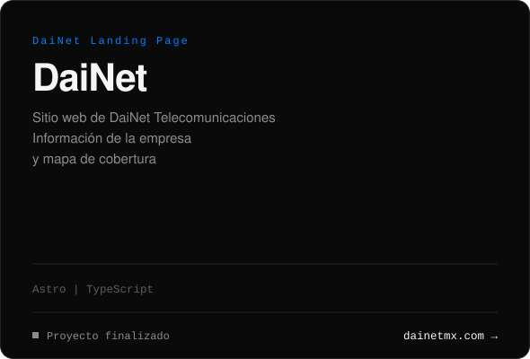
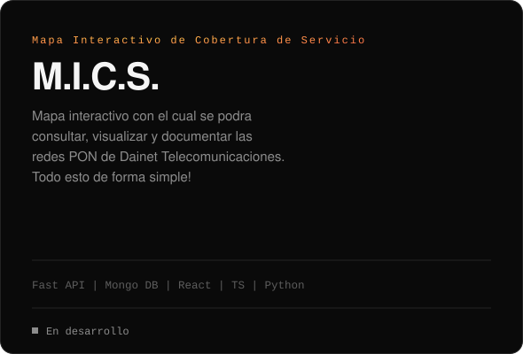
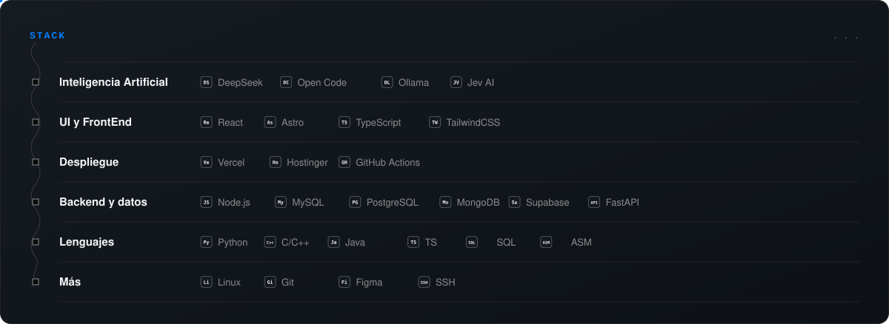

## Sobre mí
¡Hola! Mi nombre es **Diego**.

Soy un desarrollador **junior** cuyo pasatiempo es todo lo que involucre el desarrollo de software, bases de datos y otros aspectos de la computación igual de divertidos. Actualmente soy estudiante del **Tecnológico Nacional de México** en la carrera de **Ingeniería en Sistemas Computacionales** y, por suerte, ya falta poco para graduarme de la universidad.

Mi trabajo actual es en una empresa de telecomunicaciones llamada **[DaiNet Telecomunicaciones](https://dainetmx.com)**, en donde he desarrollado algunos proyectos y he tenido contacto e interacciones con infraestructura de red y telecomunicaciones.

## Proyectos

  
  

## Stack

